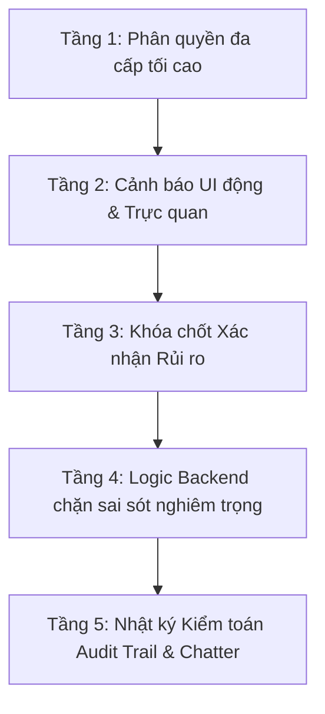

# BÁO CÁO GIẢI TRÌNH KỸ THUẬT & NGUYÊN LÝ KẾ TOÁN
## Về Việc Mở Khóa Thuộc Tính "Theo Dõi Hàng Tồn Kho", "Điểm Bán Hàng (POS)" Và "Đơn Vị Tính" Cho Tài Khoản Quản Trị Viên (Admin) Trên Odoo ERP

---

### TÓM TẮT DÀNH CHO BAN GIÁM ĐỐC & BỘ PHẬN KẾ TOÁN (EXECUTIVE SUMMARY)

| Câu hỏi trọng tâm | Kết luận & Đánh giá kỹ thuật |
| :--- | :--- |
| **1. Có thực hiện được không?** | **HOÀN TOÀN THỰC HIỆN ĐƯỢC 100%**. Hệ thống đã được cấu hình tính năng phân quyền đặc biệt dành riêng cho tài khoản **ADMIN**, cho phép sửa trực tiếp trên từng sản phẩm hoặc **chọn hàng loạt (chọn tất cả hàng ngàn sản phẩm)** để cập nhật cùng lúc. |
| **2. Tại sao trước đây phần mềm không cho chọn?** | Do cơ chế bảo vệ an toàn mặc định của Odoo toàn cầu nhằm ngăn người dùng thông thường tự ý thay đổi phương thức quản lý tồn kho khi đã có phiếu kho phát sinh. |
| **3. Sau khi tick có xem được lịch sử nhập xuất phía trước không?** | **CÓ, XEM ĐƯỢC ĐẦY ĐỦ 100%**. Toàn bộ phiếu nhập, xuất, điều chuyển kho đã làm từ trước đến nay vẫn lưu trữ vĩnh viễn trong cơ sở dữ liệu và liên kết chính xác với sản phẩm. |
| **4. Có ảnh hưởng tiêu cực đến dữ liệu kế toán cũ đã chốt không?** | **HOÀN TOÀN KHÔNG**. Các kỳ kế toán cũ, hóa đơn và chứng từ quá khứ được giữ nguyên vẹn 100%. Cơ chế hạch toán kho chỉ áp dụng cho các giao dịch mới phát sinh từ nay về sau. |
| **5. Cần làm gì sau khi bật theo dõi kho?** | Do trước đó chưa theo dõi kho, số tồn kho trên tay ban đầu sẽ hiển thị là `0`. Bộ phận kho/kế toán chỉ cần thực hiện 1 thao tác duy nhất: **Bấm "Cập nhật số lượng"** hoặc tạo một phiếu **Kiểm kê kho (Inventory Adjustment)** để nhập số lượng thực tế ngoài kho vào hệ thống. |

---

### PHẦN 1: TẠI SAO PHẦN MỀM GỐC CỦA ODOO KHÓA CỨNG KHÔNG CHO SỬA?

#### 1.1. Bản chất phân loại sản phẩm trong Odoo
Trong Odoo ERP (từ phiên bản 17 và 18 trở đi), sản phẩm hàng hóa được chia thành 2 trạng thái quản lý chính:
1. **Hàng tiêu dùng / Không theo dõi kho (`is_storable = False`):**
   - Dùng cho các mặt hàng không cần theo dõi số lượng tồn kho theo thời gian thực trên giá kệ (ví dụ: vật tư văn phòng, phụ liệu đóng gói, hoặc hàng hóa mua về xuất dùng/giao thẳng ngay).
   - **Về mặt kỹ thuật:** Odoo **không** tạo bản ghi số dư tức thời trong bảng `stock.quant` và **không** sinh ra các lớp định giá tồn kho tự động (`stock.valuation.layer`). Chi phí mua hàng thường được ghi nhận thẳng vào tài khoản Chi phí / Giá vốn khi xác nhận hóa đơn nhà cung cấp.
2. **Hàng lưu kho / Có theo dõi kho (`is_storable = True`):**
   - Dùng cho hàng hóa cần quản lý số lượng tồn chi tiết trên từng kệ/kho, kiểm soát số lượng dự báo, đặt quy tắc cung ứng tự động, và hiển thị các nút chức năng quản lý kho (*Cập nhật số lượng, Bổ sung hàng, Dự báo tồn*).
   - **Về mặt kế toán:** Khi áp dụng định giá kho tự động, mỗi lần nhập kho sẽ ghi tăng Tài khoản Tồn kho (TK 156) và mỗi lần xuất kho sẽ ghi nhận Giá vốn (TK 632).

#### 1.2. Lý do Odoo cài đặt cơ chế "Khóa cứng" (Hard Lock)
Odoo là phần mềm ERP tiêu chuẩn quốc tế phục vụ nhiều mô hình doanh nghiệp lớn. Để tránh việc nhân viên nghiệp vụ thao tác sai làm xáo trộn số liệu kế toán:
- Odoo đặt một quy tắc kiểm tra an toàn trong mã nguồn:
  > *Nếu một sản phẩm đã từng phát sinh bất kỳ một dòng di chuyển kho nào ở trạng thái hoàn thành (`state = 'done'`), hệ thống sẽ lập tức chặn việc bật/tắt ô Theo dõi kho bằng thông báo lỗi:*
  > `"You can not change the inventory tracking of a product that was already used."` *(Bạn không thể thay đổi theo dõi tồn kho của sản phẩm đã từng phát sinh giao dịch).*
- Tương tự với **Đơn vị tính (`uom_id`)**, Odoo cũng chặn không cho sửa khi đã có phiếu di chuyển kho vì lo ngại việc thay đổi đơn vị tính (ví dụ từ *Cái* sang *Thùng* hoặc sang *Kg*) sẽ làm sai lệch tỷ lệ quy đổi số lượng của các phiếu cũ.

> **Kết luận:** Việc Odoo không cho sửa **không phải** do lỗi phần mềm, mà là **hàng rào bảo vệ mặc định** dành cho user thường. Tuy nhiên, trong thực tế triển khai, kế toán hoặc nhân viên tạo dữ liệu ban đầu hoàn toàn có thể bị nhầm lẫn (tạo nhầm không tick kho, chọn nhầm đơn vị tính). Do đó, **cần trao quyền đặc biệt cho Quản trị viên (ADMIN)** để can thiệp chuẩn hóa lại dữ liệu.

---

### PHẦN 2: ĐÁNH GIÁ CHI TIẾT ẢNH HƯỞNG ĐẾN DỮ LIỆU & LỊCH SỬ GIAO DỊCH

#### 2.1. Lịch sử nhập xuất phía trước có xem lại được không?
- **Câu trả lời:** **XEM ĐƯỢC 100% ĐẦY ĐỦ VÀ CHÍNH XÁC.**
- **Cơ chế kỹ thuật:** Tất cả các phiếu nhập kho (PO Receipt), phiếu xuất bán (SO Delivery), phiếu điều chuyển nội bộ (`stock.picking`, `stock.move`, `stock.move.line`) đã diễn ra trong quá khứ đều được lưu trữ cố định trong cơ sở dữ liệu với khóa ngoại `product_id`.
- Trường `is_storable` trên các dòng di chuyển là trường liên kết động (`related='product_id.is_storable'`). Khi Admin bật ô này lên `True`, toàn bộ các dòng di chuyển kho cũ sẽ tự động phản ánh trạng thái có theo dõi.
- Người dùng bấm vào nút **"Di chuyển" (Product Moves)** trên form sản phẩm hoặc xem **Báo cáo di chuyển kho** sẽ thấy toàn bộ lịch sử từ ngày đầu tiên hệ thống vận hành.

#### 2.2. Số lượng tồn kho tức thời (Số lượng trên tay - On Hand Qty) hiển thị thế nào?
- **Hiện tượng thực tế:** Ngay sau khi tick bật ô "Theo dõi hàng tồn kho", số lượng trên tay của sản phẩm sẽ hiển thị ban đầu là **`0`**.
- **Nguyên nhân:** Khi sản phẩm chưa tick theo dõi kho, các lần xuất nhập trước đó đã bị Odoo bỏ qua bước ghi nhận số dư vào bảng quản lý tồn kho tức thời (`stock.quant`).
- **Giải pháp xử lý (Rất đơn giản và đúng nghiệp vụ kế toán kho):**
  - Sau khi bật theo dõi kho, nhân viên kho/kế toán thực hiện kiểm đếm thực tế và:
    + **Cách 1 (Từng sản phẩm):** Bấm nút **"Cập nhật số lượng"** trực tiếp trên màn hình sản phẩm, nhập số lượng thực tế đang có trong kho ➔ Bấm Áp dụng.
    + **Cách 2 (Hàng loạt nhiều mã):** Vào menu **Kho vận ➔ Kiểm kê kho (Inventory Adjustments)**, tạo phiếu kiểm kê danh sách các sản phẩm mới bật theo dõi, nhập số đếm thực tế và bấm Xác nhận kiểm kê.
  - Sau bước này, hệ thống sẽ đồng bộ số lượng tồn kho chuẩn xác 100% và mọi giao dịch nhập xuất mới từ đó về sau sẽ tự động cộng trừ chính xác theo thời gian thực.

#### 2.3. Có ảnh hưởng đến Sổ sách kế toán và Báo cáo tài chính cũ không?
- **Câu trả lời:** **HOÀN TOÀN KHÔNG ẢNH HƯỞNG.**
- Các hóa đơn mua hàng, hóa đơn bán hàng và các bút toán sổ cái (`account.move`, `account.move.line`) của các kỳ kế toán trước đây đã được xác nhận (Posted) và chốt sổ.
- Việc thay đổi cờ `is_storable` trên sản phẩm **chỉ có hiệu lực cho các chứng từ phát sinh mới** kể từ thời điểm thay đổi trở đi. Hệ thống **không** can thiệp ngược lại và **không** tự động sinh lại bút toán của quá khứ.
- Báo cáo tài chính, Báo cáo kết quả kinh doanh và Bảng cân đối tài khoản của các tháng/năm trước được bảo lưu nguyên vẹn 100%.

#### 2.4. Đổi Đơn vị tính (`uom_id`) có rủi ro gì không?
- Khi nhân viên kế toán tạo nhầm đơn vị tính (ví dụ: *Bộ* nhầm thành *Cái*, hoặc ngược lại):
  - Admin được quyền sửa lại đúng đơn vị tính thực tế.
  - Hệ thống sẽ tự động đồng bộ cả Đơn vị tính mua hàng (`uom_po_id`) về cùng nhóm đơn vị tính để đảm bảo tính hợp lệ của Odoo.
  - **Khuyến nghị nghiệp vụ:** Sau khi sửa đơn vị tính của một mã hàng đã có tồn kho cũ, thủ kho cần kiểm kê lại số lượng để đảm bảo con số tồn kho khớp đúng với đơn vị tính mới.

---

### PHẦN 3: CƠ CHẾ BẢO VỆ AN TOÀN 5 TẦNG CHO DOANH NGHIỆP LỚN

Để phục vụ doanh nghiệp có quy mô tài sản lớn và doanh số hàng tỷ đồng, hệ thống đã được trang bị **5 tầng bảo vệ an toàn nghiêm ngặt (Fail-Safe Locks)**:



#### Tầng 1: Phân quyền đa cấp tối cao (Duy nhất ADMIN)
* **Giao diện:** Ẩn hoặc khóa `readonly="1"` toàn bộ đối với tất cả nhân viên bình thường (Nhân viên kinh doanh, Kế toán kho, Kỹ thuật...).
* **Menu Hành động (Action):** Chỉ hiển thị cho tài khoản Quản trị viên tối cao (`base.group_system`).
* **Phân quyền Model ACL:** Chặn truy cập wizard ở tầng cơ sở dữ liệu (`ir.model.access.csv`).
* **Hàm ghi dữ liệu (ORM write):** Ném lỗi `AccessError` ngay lập tức nếu người dùng không phải Admin cố tình can thiệp qua API hoặc RPC.

#### Tầng 2: Khung cảnh báo trực quan trên giao diện (Dynamic UI Warnings)
* Khi Admin tích chọn **"Thay đổi Theo dõi tồn kho"**: Hệ thống lập tức hiển thị khung cảnh báo màu vàng cam nhấn mạnh: *Số tồn ban đầu sẽ hiển thị là 0 và bắt buộc phải làm phiếu Kiểm kê kho thực tế sau khi áp dụng.*
* Khi Admin tích chọn **"Thay đổi Đơn vị tính"**: Hệ thống hiển thị khung cảnh báo màu đỏ đậm: *Chỉ đổi khi tạo nhầm và bắt buộc kiểm tra lại tỷ lệ quy đổi số lượng/giá vốn.*

#### Tầng 3: Khóa chốt an toàn bắt buộc xác nhận rủi ro (Mandatory Fail-Safe Confirmation)
* Khi có bất kỳ thay đổi nào liên quan đến Tồn kho hoặc Đơn vị tính, Wizard bắt buộc Admin phải tích chọn vào ô chốt an toàn:
  > **`[x] XÁC NHẬN RỦI RO & TRÁCH NHIỆM: Tôi xác nhận là Quản trị viên, tôi đã hiểu rõ các tác động về tồn kho (bắt buộc kiểm kê lại) & đơn vị tính và chịu trách nhiệm khi thực hiện.`**
* Nếu Admin chưa tích ô này mà bấm *"Áp dụng thay đổi"*, hệ thống lập tức từ chối và yêu cầu đọc kỹ cảnh báo.

#### Tầng 4: Logic Backend ngăn chặn các lỗi sai nghiêm trọng
1. **Chặn tắt Theo dõi tồn kho khi hàng vẫn còn trong kho:** Nếu một sản phẩm đang có số lượng tồn kho khác `0` (`qty_available != 0`), hệ thống **tuyệt đối không cho phép** tắt theo dõi tồn kho để tránh tình trạng hàng hóa thực tế bị "bốc hơi" khỏi quản lý.
2. **Nghiêm cấm đổi Đơn vị tính sai nhóm:** Nếu sản phẩm đã từng có phiếu kho hoàn thành, hệ thống chặn tuyệt đối việc đổi sang nhóm đơn vị tính khác loại (ví dụ từ nhóm *Đơn vị đếm - Cái* sang nhóm *Khối lượng - Kg* hoặc *Thể tích*).

#### Tầng 5: Nhật ký kiểm toán tự động (Audit Trail & Chatter Log)
* Mỗi lần Admin thực hiện cập nhật đặc quyền (dù là 1 sản phẩm hay hàng nghìn sản phẩm), hệ thống đều:
  1. Ghi log cảnh báo mức độ cao vào Server log (`_logger.warning`).
  2. Tự động đăng một bản ghi kiểm toán màu cam vào khung trao đổi (**Chatter**) của từng sản phẩm: ghi rõ ai đã thực hiện, lúc mấy giờ, nội dung thay đổi chi tiết là gì.
* Điều này giúp doanh nghiệp có đầy đủ bằng chứng đối soát, minh bạch 100% trách nhiệm và không bao giờ xảy ra tình trạng "không biết ai đã bấm sửa".

---

### PHẦN 4: HƯỚNG DẪN QUY TRÌNH THỰC HIỆN TỪNG BƯỚC

```mermaid
graph TD
    A[Bước 1: Tài khoản ADMIN lọc & chọn sản phẩm] --> B[Bước 2: Mở Wizard 'Chỉnh sửa thuộc tính sản phẩm (Admin)']
    B --> C[Bước 3: Tick thuộc tính cần sửa & Đọc cảnh báo]
    C --> D[Bước 4: Tích ô 'XÁC NHẬN RỦI RO' & Bấm Áp dụng]
    D --> E[Bước 5: Thủ kho làm phiếu Kiểm kê kho đối soát]
    E --> F[Bước 6: Nhập số lượng thực tế & Xác nhận - Hoàn tất]
```

1. **Bước 1:** Đăng nhập bằng tài khoản **ADMIN**. Vào menu **Sản phẩm ➔ Sản phẩm**.
2. **Bước 2:** Sử dụng bộ lọc tìm kiếm các sản phẩm cần chuyển đổi. Chọn các sản phẩm (hoặc bấm chọn tất cả).
3. **Bước 3:** Vào menu **Hành động (Action)** ➔ Chọn **`Chỉnh sửa thuộc tính sản phẩm (Admin)`**.
4. **Bước 4:**
   - Tick vào thuộc tính muốn đổi (**Theo dõi tồn kho**, **Bán trên POS**, **Đơn vị tính**).
   - Đọc kỹ khung cảnh báo nghiệp vụ màu vàng/đỏ.
   - Tích chọn ô **`XÁC NHẬN RỦI RO & TRÁCH NHIỆM`**.
   - Bấm **`Áp dụng thay đổi (Admin)`**.
5. **Bước 5 (Bắt buộc):** Bộ phận Kho thực hiện đếm thực tế và cập nhật số lượng tồn kho (bằng nút *Cập nhật số lượng* hoặc phiếu *Kiểm kê kho*).
6. **Bước 6:** Hoàn tất quy trình, dữ liệu kho được chuẩn hóa và đồng bộ chính xác 100%.
