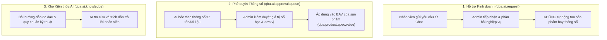
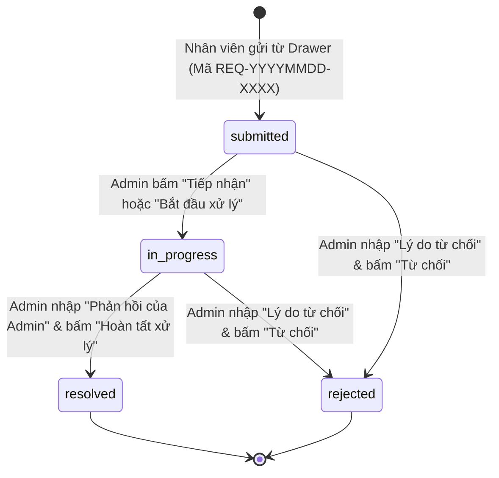

# SỔ TAY VẬN HÀNH KỸ THUẬT & QUẢN TRỊ VIÊN QBA AI (ADMIN & TECHNICAL OPERATIONS GUIDE)

**Hệ thống:** QBA AI — Phân hệ Odoo 18 Community  
**Đối tượng áp dụng:** Quản trị viên Kỹ thuật, Trưởng bộ phận Phụ tùng, Quản trị hệ thống (`qba_ai.group_qba_ai_manager`)  
**Tài liệu liên kết:** [USER_MANUAL.md](file:///e:/hoctap/Language/Python/qba-odoo/staging-qba-odoo/odoo/custom_addons/qba_ai/doc/USER_MANUAL.md), [TECHNICAL_VERIFICATION_MATRIX.md](file:///e:/hoctap/Language/Python/qba-odoo/staging-qba-odoo/odoo/custom_addons/qba_ai/doc/TECHNICAL_VERIFICATION_MATRIX.md)  
**Cập nhật lần cuối:** 21/10/2026 (Hiệu đính Phân quyền thực tế & Quy trình vận hành an toàn)  

---

## 1. PHÂN BIỆT RÕ RÀNG 3 QUY TRÌNH QUẢN TRỊ ĐỘC LẬP

Để tránh nhầm lẫn trong vận hành, Quản trị viên cần phân biệt rõ 3 quy trình sau:



---

## 2. QUY TRÌNH TIẾP NHẬN & XỬ LÝ YÊU CẦU HỖ TRỢ (ADMIN REQUESTS)

### 2.1. Truy cập & Bộ lọc
- **Đường dẫn menu:** **QBA AI Assistant** → **Yêu cầu hỗ trợ** → **Tất cả yêu cầu** (`action_qba_ai_request_all`).
- **Giao diện:** Hỗ trợ 3 chế độ xem: **Danh sách (List)**, **Kanban**, và **Biểu mẫu (Form)**.
- **Bộ lọc mặc định:** Tự động lọc các yêu cầu ở trạng thái `Chờ tiếp nhận (submitted)` và `Đang xử lý (in_progress)`.

### 2.2. Vòng đời xử lý phiếu yêu cầu



### 2.3. Ràng buộc trường dữ liệu bắt buộc (Data Validation)
Mã nguồn backend [`custom_addons/qba_ai/models/ai_request.py`](file:///e:/hoctap/Language/Python/qba-odoo/staging-qba-odoo/odoo/custom_addons/qba_ai/models/ai_request.py#L225) thực thi kiểm tra chặt chẽ:
1. **Khi hoàn tất (`resolved`):** Trường `admin_feedback` (Phản hồi của Admin) **bắt buộc phải có nội dung**. Nếu để trống, hệ thống sẽ chặn và báo lỗi `ValidationError`.
2. **Khi từ chối (`rejected`):** Trường `rejection_reason` (Lý do từ chối) **bắt buộc phải có nội dung** để nhân viên hiểu rõ lý do không tiếp nhận.

### 2.4. Truy vết ngữ cảnh hội thoại gốc
- Trên Form của phiếu yêu cầu, bấm nút **"Xem hội thoại QBA AI"** (`action_open_conversation`).
- Hệ thống sẽ mở trực tiếp bản ghi hội thoại liên kết (`qba.ai.conversation`), hiển thị trọn vẹn toàn bộ các lượt chat, câu hỏi của khách và các đề xuất AI đã đưa ra trước khi nhân viên bấm gửi yêu cầu.

### 2.5. Xử lý các loại yêu cầu cụ thể
| Loại yêu cầu | Ý nghĩa | Hành động nghiệp vụ của Admin |
| :--- | :--- | :--- |
| **`missing_product`** | Sản phẩm chưa có trong danh mục kho QBA | Kiểm tra catalogue nhà cung cấp. Nếu nhập về, vào phân hệ **Kho/Bán hàng** tạo mới `product.template`, sau đó nhập mã SKU mới vào phản hồi và bấm "Hoàn tất xử lý". |
| **`missing_spec`** | Sản phẩm thiếu thông số kỹ thuật then chốt | Xuất kho đo mẫu thực tế (đường kính ngoài, then hoa, moay-ơ C/D). Cập nhật thông số vào tab **Thông Số Kỹ Thuật** của sản phẩm, rồi phản hồi cho nhân viên. |
| **`spec_conflict`** | Thông số thực tế mâu thuẫn / sai lệch | Đo kiểm tra lại sản phẩm trong kho. Nếu dữ liệu trên hệ thống sai, chỉnh sửa lại thông số EAV của sản phẩm. |
| **`substitute_review`**| Xác minh phụ tùng thay thế lắp lẫn | Kỹ sư trưởng đối chiếu bản vẽ/kích thước moay-ơ. Kết luận rõ: "Khớp hình học hoàn toàn", "Thay thế có điều kiện (kèm lưu ý)", hoặc "Không tương thích". |

> [!CAUTION]
> Bấm "Hoàn tất xử lý" trên phiếu yêu cầu **KHÔNG TỰ ĐỘNG TẠO SẢN PHẨM HOẶC THÔNG SỐ**. Đây là phiếu giao việc và phản hồi kết quả. Quản trị viên phải thực hiện thao tác tạo/sửa sản phẩm trên phân hệ Sản phẩm chuẩn của Odoo.

---

## 3. HÀNG ĐỢI PHÊ DUYỆT THÔNG SỐ KỸ THUẬT (APPROVAL QUEUE)

### 3.1. Mục đích & Nguyên lý ranh giới an toàn
- **Đường dẫn:** **QBA AI Assistant** → **Cấu hình** → **Hàng Đợi Phê Duyệt Thông Số** (`action_qba_ai_approval_queue`).
- Khi hệ thống nạp sản phẩm mới hoặc phân tích tự động từ tài liệu, các thông số kỹ thuật được đưa vào hàng đợi `qba.ai.approval.queue` ở trạng thái `pending`.
- **Ranh giới an toàn tuyệt đối:** Công cụ tìm kiếm AI chỉ sử dụng các thông số có trạng thái `verified` (do kỹ thuật nhập) hoặc `approved` (do Admin duyệt). Bất kỳ thông số nào đang `pending` hoặc `conflict` đều bị loại trừ khỏi phép đối chiếu thay thế.

### 3.2. Quy trình kiểm duyệt
1. Mở danh sách thông số chờ duyệt.
2. Kiểm tra các trường:
   - **Sản phẩm:** Đối chiếu với tên sản phẩm thực tế.
   - **Tên thông số:** Ví dụ `duong_kinh_ngoai`, `rang`, `lo_xo`, `duong_kinh_moay_o_c`, `duong_kinh_moay_o_d`.
   - **Giá trị đề xuất:** Đảm bảo đúng kiểu dữ liệu (Số nguyên cho răng/lò xo, số thực cho mm).
   - **Đơn vị tính:** mm, cái, răng.
3. Bấm **"Phê duyệt"**: Thông số được ghi vào `qba.product.spec.value` và lập tức có hiệu lực tìm kiếm.
4. Bấm **"Từ chối"**: Bác bỏ và hủy giá trị đề xuất.

---

## 4. QUẢN TRỊ KHO KIẾN THỨC AI (AI KNOWLEDGE BASE)

### 4.1. Cấu trúc bài viết kiến thức
- **Đường dẫn:** **QBA AI Assistant** → **Cấu hình** → **Kho Kiến Thức AI** (`action_qba_ai_knowledge`).
- Mỗi bài kiến thức bao gồm:
  - **Tiêu đề:** Tên quy chuẩn kỹ thuật (Ví dụ: *Quy trình đo đường kính then hoa đĩa ly hợp*).
  - **Danh mục:** Phân loại chuyên môn (Ví dụ: `LC - Lá côn`, `BAPD - Bạc ắc phi dê`).
  - **Từ khóa nhận diện (Keywords):** Danh sách từ khóa phân cách bằng dấu phẩy (Ví dụ: `đo then hoa, số răng, thước cặp, phi then`).
  - **Nội dung hướng dẫn (HTML):** Mô tả chi tiết các bước đo đạc, vị trí đặt mỏ cặp của thước cặp cơ khí, sai số cho phép.

### 4.2. Cách AI khai thác kiến thức
Khi nhân viên kinh doanh đặt câu hỏi chứa từ khóa kỹ thuật (ví dụ: *"hướng dẫn cách đo đĩa phanh"*, *"then hoa 10 răng đo như thế nào"*):
- AI kích hoạt Intent `measurement_guide` hoặc `technical_spec_only`.
- Tìm kiếm bài viết có điểm khớp cao nhất trong Kho Kiến Thức.
- Trích xuất nội dung và hiển thị định dạng chuẩn trong khung trả lời Drawer.

---

## 5. PHÂN TÍCH MA TRẬN PHÂN QUYỀN THỰC TẾ (PERMISSIONS AUDIT)

Dựa trên kiểm tra thực tế tại [`ir.model.access.csv`](file:///e:/hoctap/Language/Python/qba-odoo/staging-qba-odoo/odoo/custom_addons/qba_ai/security/ir.model.access.csv), [`qba_ai_security.xml`](file:///e:/hoctap/Language/Python/qba-odoo/staging-qba-odoo/odoo/custom_addons/qba_ai/security/qba_ai_security.xml), và các method ORM trong thư mục `models/`:

| Mô hình (Model) | Quyền Người dùng thường (`group_qba_ai_user`) | Quyền Quản trị viên (`group_qba_ai_manager`) | Ràng buộc bảo vệ cấp ORM (Python Constraints) |
| :--- | :---: | :---: | :--- |
| `qba.ai.conversation` | Read/Write/Create/Unlink (Chỉ phiên của mình) | Read/Write/Create/Unlink (Toàn bộ) | Phân quyền qua Record Rule `conversation_user_rule`. Nhân viên không thể mở phiên của người khác. |
| `qba.ai.message` | Read/Write/Create/Unlink (Chỉ tin nhắn của mình) | Read/Write/Create/Unlink (Toàn bộ) | Ràng buộc theo quyền của `conversation_id`. |
| `qba.ai.request` | Read/Create/Write (Hạn chế), **Unlink: KHÔNG** | Read/Write/Create/Unlink (Toàn bộ) | Người dùng thường không thể sửa các trường bảo vệ (`state`, `handler_id`, `admin_feedback`). Phương thức `unlink()` chặn hoàn toàn người dùng thường. |
| `qba.ai.approval.queue` | Read/Write/Create, **Unlink: KHÔNG** | Read/Write/Create/Unlink (Toàn bộ) | Phương thức `unlink()` và `write()` chặn sửa đổi khi bản ghi đã duyệt/từ chối. |
| `qba.ai.knowledge` | **Chỉ Đọc (Read Only)** | Read/Write/Create/Unlink (Toàn bộ) | Phương thức `write()` và `unlink()` ném `AccessError` nếu không phải Quản trị viên. |
| `qba.product.spec.definition` | **Chỉ Đọc (Read Only)** | Read/Write/Create/Unlink (Có điều kiện) | **Bảo vệ toàn vẹn dữ liệu:** Quản trị viên **KHÔNG THỂ XÓA** định nghĩa thông số nếu đã có giá trị `verified` liên kết (ném `ValidationError`). Bắt buộc dùng `active = False`. |
| `qba.product.spec.value` | Read/Write/Create, **Unlink: KHÔNG** | Read/Write/Create/Unlink (Toàn bộ) | Người dùng thường không thể xóa thông số đã `verified`. Chỉ Quản trị viên mới có quyền xóa. |

---

## 6. QUY TRÌNH THỰC THI LỆNH STAGING AN TOÀN (SAFE STAGING OPERATIONS CHECKLIST)

> [!CAUTION]
> **Quy định nghiêm ngặt về môi trường Staging:**  
> Tuyệt đối không chạy lệnh nâng cấp module (`-u`) hoặc khởi động lại container trên cơ sở dữ liệu dùng chung khi đang kiểm thử nhánh tính năng, trừ khi môi trường đã được xác nhận cách ly độc lập.

### 6.1. Bảng thông số môi trường Staging cách ly
- **Nhánh Git chỉ định:** `feature/integrate-ai-product-search`
- **Cơ sở dữ liệu Staging:** `qba` (môi trường thử nghiệm cách ly nội bộ)
- **Tên container Docker:** `staging-qba-odoo-1`
- **Cấu hình Odoo trong container:** `/app/debian/odoo.conf`
- **Cổng dịch vụ máy chủ:** Cổng host `8089` (nội bộ container `8069`)

### 6.2. Các bước vận hành chuẩn và lệnh an toàn

#### Bước 1: Sao lưu cơ sở dữ liệu trước khi nâng cấp (Bắt buộc)
Trước khi nâng cấp schema hoặc thêm trường dữ liệu mới:
```bash
docker exec staging-qba-odoo-1 pg_dump -U odoo -h postgres -F c qba > /var/lib/odoo/backup_qba_pre_upgrade.dump
```
- *Mục đích:* Tạo điểm khôi phục nhanh nếu quá trình upgrade gặp sự cố về bảng dữ liệu.

#### Bước 2: Nâng cấp module trên cổng phụ cách ly
Khi nâng cấp addon `qba_ai`, luôn chỉ định `--http-port=8070` và `--stop-after-init` để không chiếm dụng hoặc xung đột cổng với tiến trình web chính đang chạy trên cổng 8069:
```bash
docker exec staging-qba-odoo-1 python3 /app/odoo-bin \
  -c /app/debian/odoo.conf \
  -d qba \
  -u qba_ai \
  --stop-after-init \
  --http-port=8070
```
- *Tác động dữ liệu:* Cập nhật định nghĩa bảng, views XML, menus và nạp dữ liệu mặc định trong `data/default_data.xml`.

#### Bước 3: Tải lại tiến trình dịch vụ Odoo (Khi có thay đổi file Python/XML)
Do container chạy không có thư viện `inotify`, sau khi nâng cấp cần khởi động lại container để tải lại mã nguồn vào bộ nhớ:
```bash
docker restart staging-qba-odoo-1
```

#### Bước 4: Khôi phục dữ liệu khi phát sinh sự cố (Rollback Plan)
Nếu quá trình nâng cấp thất bại hoặc gây lỗi dữ liệu:
```bash
# Dừng container
docker stop staging-qba-odoo-1
# Khôi phục cơ sở dữ liệu từ bản dump
docker exec -i staging-qba-odoo-1 pg_restore -U odoo -h postgres -d qba --clean /var/lib/odoo/backup_qba_pre_upgrade.dump
# Khởi động lại container
docker start staging-qba-odoo-1
```
