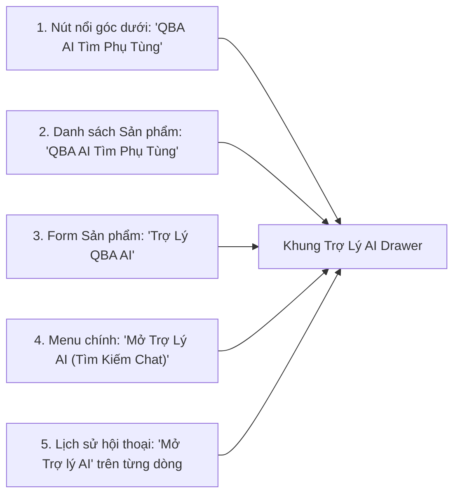
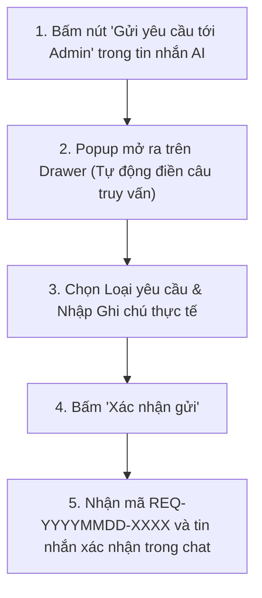

# TÀI LIỆU HƯỚNG DẪN SỬ DỤNG HỆ THỐNG TRỢ LÝ QBA AI (USER MANUAL)

**Dành cho:** Nhân viên Kinh doanh, Tư vấn bán hàng và Kỹ thuật viên phụ tùng  
**Hệ thống:** Phân hệ QBA AI trên nền tảng Odoo 18 Community Edition  
**Tài liệu tham chiếu:** [ADMIN_OPERATIONS_GUIDE.md](file:///e:/hoctap/Language/Python/qba-odoo/staging-qba-odoo/odoo/custom_addons/qba_ai/doc/ADMIN_OPERATIONS_GUIDE.md), [TECHNICAL_VERIFICATION_MATRIX.md](file:///e:/hoctap/Language/Python/qba-odoo/staging-qba-odoo/odoo/custom_addons/qba_ai/doc/TECHNICAL_VERIFICATION_MATRIX.md)  
**Cập nhật lần cuối:** 21/10/2026 (Hiệu đính độ chính xác dữ liệu & An toàn vận hành)  

---

## MỤC LỤC
1. [GIỚI THIỆU TỔNG QUAN](#1-giới-thiệu-tổng-quan)
2. [CÁC NGUYÊN TẮC AN TOÀN KỸ THUẬT BẮT BUỘC](#2-các-nguyên-tắc-an-toàn-kỹ-thuật-bắt-buộc)
3. [CÁC VỊ TRÍ KHỞI CHẠY TRỢ LÝ QBA AI](#3-các-vị-trí-khởi-chạy-trợ-lý-qba-ai)
4. [HƯỚNG DẪN TÌM KIẾM PHỤ TÙNG & ĐỐI CHIẾU THÔNG SỐ](#4-hướng-dẫn-tìm-kiếm-phụ-tùng--đối-chiếu-thông-số)
   - 4.1. Tra cứu theo mã SKU chính xác
   - 4.2. Tra cứu theo thông số kỹ thuật đa chiều
   - 4.3. Hội thoại liên tục nhiều lượt (Multi-turn Context)
   - 4.4. Sử dụng Chip gợi ý nhanh (Quick Chips)
5. [ĐỐI CHIẾU KỸ THUẬT & XỬ LÝ KHI THIẾU DỮ LIỆU](#5-đối-chiếu-kỹ-thuật--xử-lý-khi-thiếu-dữ-liệu)
   - 5.1. Bảng đối chiếu thông số thực tế giữa LC.002 và LC.007
   - 5.2. Các cấp độ đánh giá tương thích an toàn
6. [QUẢN LÝ PHIÊN HỘI THOẠI (LỊCH SỬ CHAT)](#6-quản-lý-phiên-hội-thoại-lịch-sử-chat)
   - 6.1. Danh sách lịch sử hội thoại cá nhân
   - 6.2. Mở và chuyển phiên hội thoại (Nút "Mở Trợ lý AI")
   - 6.3. Lưu trữ và Khôi phục phiên hội thoại
7. [QUY TRÌNH GỬI YÊU CẦU HỖ TRỢ ADMIN (ADMIN REQUEST)](#7-quy-trình-gửi-yêu-cầu-hỗ-trợ-admin-admin-request)
   - 7.1. Khi nào gửi yêu cầu hỗ trợ?
   - 7.2. Các bước gửi yêu cầu từ khung chat
   - 7.3. Theo dõi tiến độ tại "Yêu Cầu Của Tôi"
8. [XỬ LÝ SỰ CỐ THƯỜNG GẶP (TROUBLESHOOTING)](#8-xử-lý-sự-cố-thường-gặp-troubleshooting)

---

## 1. GIỚI THIỆU TỔNG QUAN

**Trợ lý QBA AI** là công cụ thông minh được tích hợp trực tiếp vào Odoo 18 nhằm hỗ trợ nhân viên bán hàng và kỹ thuật viên phụ tùng xe tải hạng nặng của QBA:
- **Tra cứu nhanh phụ tùng:** Tìm kiếm sản phẩm theo mã SKU, tên phụ tùng, hoặc các thông số đo lường thực tế (đường kính, số răng then hoa, số lò xo, thương hiệu...).
- **Đối chiếu thông số kỹ thuật:** Bóc tách và so sánh song song các chỉ số kích thước then chốt theo mô hình EAV (Entity-Attribute-Value).
- **Quy trình kết nối Admin tức thời:** Tự động mở form gửi yêu cầu hỗ trợ kỹ thuật khi kho chưa có sản phẩm hoặc thông số đo bị thiếu/mâu thuẫn.

---

## 2. CÁC NGUYÊN TẮC AN TOÀN KỸ THUẬT BẮT BUỘC

> [!CAUTION]
> **Nhân viên tư vấn bán hàng và kỹ thuật viên phụ tùng bắt buộc phải tuân thủ nghiêm ngặt các quy định an toàn kỹ thuật sau:**

1. **Tuyệt đối không suy diễn khả năng thay thế:**  
   Điểm số tương đồng cao hoặc một vài kích thước cơ bản trùng khớp **chưa đủ để khẳng định hai phụ tùng có thể lắp lẫn an toàn**. Các phụ tùng xe tải hạng nặng chịu lực xoắn và tải trọng lớn; việc lắp nhầm có thể gây hỏng hóc nghiêm trọng hệ thống truyền động.
2. **Chỉ tin cậy dữ liệu đã phê duyệt chính thức:**  
   Chỉ các thông số kỹ thuật đã có trạng thái **Đã xác minh (`verified`)** hoặc **Đã phê duyệt (`approved`)** bởi kỹ sư/Admin mới được sử dụng để tư vấn lắp lẫn. Các thông số ở trạng thái chờ duyệt (`pending`) hoặc mâu thuẫn (`conflict`) luôn bị hệ thống loại trừ khỏi thuật toán tương thích.
3. **Minh bạch khi thiếu thông số cốt lõi:**  
   Nếu sản phẩm đề xuất bị thiếu dữ liệu đo đạc (ví dụ: thiếu đường kính moay-ơ C hoặc D), nhân viên phải thông báo rõ ràng cho khách hàng rằng dữ liệu chưa đủ và **bắt buộc phải đo kiểm thực tế trên chi tiết phụ tùng trước khi xuất kho**.
4. **Quy tắc thay thế có điều kiện:**  
   Mọi đề xuất thay thế phụ tùng dạng "Có điều kiện" bắt buộc phải dựa trên quy chuẩn kỹ thuật đã được kỹ sư trưởng hoặc Quản trị viên duyệt. Tuyệt đối không tự ý phát minh quy tắc thay thế cho bất kỳ danh mục nào.
5. **Chuyển tiếp Admin khi nghi ngờ:**  
   Trong mọi trường hợp phát hiện mâu thuẫn kích thước thực tế hoặc chưa rõ khả năng lắp lẫn, nhân viên phải sử dụng nút **"Gửi yêu cầu tới Admin"** để được xác minh chính thức.

---

## 3. CÁC VỊ TRÍ KHỞI CHẠY TRỢ LÝ QBA AI

Bạn có thể mở khung Trợ lý QBA AI (Slide-in Drawer) từ 5 vị trí thuận tiện trên hệ thống:



1. **Nút bấm nổi góc dưới màn hình (`QBA AI Tìm Phụ Tùng`):**  
   Hiển thị cố định ở góc dưới bên phải trên mọi màn hình. Bấm vào để mở hoặc đóng khung chat Drawer.
2. **Thanh công cụ Danh sách Sản phẩm (List View):**  
   Nút **"QBA AI Tìm Phụ Tùng"** (màu xanh dương) trên thanh công cụ phía trên danh sách sản phẩm.
3. **Thanh tiêu đề Chi tiết Sản phẩm (Form View):**  
   Nút **"Trợ Lý QBA AI"** trên header form sản phẩm. Khi bấm, AI tự động gán sản phẩm bạn đang xem làm sản phẩm mốc (Context Product) để đối chiếu kỹ thuật.
4. **Menu ứng dụng Odoo:**  
   Vào menu **QBA AI Assistant** → **Chức năng AI** → **Mở Trợ Lý AI (Tìm Kiếm Chat)**.
5. **Nút thao tác trên Lịch sử hội thoại:**  
   Vào menu **Lịch Sử Hội Thoại QBA AI**, bấm nút **"Mở Trợ lý AI"** ở Cột 2 trên bất kỳ dòng nào.

---

## 4. HƯỚNG DẪN TÌM KIẾM PHỤ TÙNG & ĐỐI CHIẾU THÔNG SỐ

### 4.1. Tra cứu theo mã SKU chính xác
- **Cách thực hiện:** Nhập trực tiếp mã SKU vào ô nhập liệu ở đáy Drawer và nhấn **Enter**.
- **Dữ liệu thực tế từ kho QBA:**
  - Nhập: `LC.001` → Trả về: *Lá côn phi 255-10R/6 lò xo BJ1041 (Antek)*
  - Nhập: `LC.002` → Trả về: *Lá côn phi 325-10R 31/38 8 lò xo CA142 (Antek)*
  - Nhập: `LC.007` → Trả về: *Lá côn phi 325-10R 31/38 8 lò xo (FOTON) chính hãng*
  - Nhập: `DTNC.001` → Trả về: *Đồng tốc nhanh chậm 18/18/18 then Howo/Dongfeng (CREATEK)*
- **Kết quả:** Thẻ sản phẩm hiển thị mã SKU, tên đầy đủ, thương hiệu, giá bán niêm yết và nút liên kết xem chi tiết.

### 4.2. Tra cứu theo thông số kỹ thuật đa chiều
Hệ thống hỗ trợ bóc tách tự động các thông số kích thước, số răng và thương hiệu:
- **Ví dụ truy vấn:** `lá côn 325 10 răng`
- **Các thông số AI trích xuất:**
  - Đường kính ngoài (`duong_kinh_ngoai`): `325 mm`
  - Số răng then hoa (`rang`): `10 răng`
- **Kết quả trả về:** Lọc chính xác các sản phẩm lá côn có $\varnothing 325$ và 10 then hoa trong kho (mã `LC.002` của Antek và mã `LC.007` của FOTON).

### 4.3. Hội thoại liên tục nhiều lượt (Multi-turn Context)
Hệ thống lưu giữ bộ lọc qua từng lượt chat trong phiên, cho phép bạn thu hẹp hoặc thay đổi điều kiện mà không cần nhập lại câu hỏi dài:

```mermaid
sequenceDiagram
    autonumber
    actor NV as Nhân viên
    participant AI as Trợ lý QBA AI

    NV->>AI: Lượt 1: "lá côn 325 10 răng"
    AI-->>NV: Tìm thấy 2 sản phẩm: LC.002 (Antek) và LC.007 (FOTON)

    NV->>AI: Lượt 2: "chỉ lấy hãng Antek"
    Note over AI: Giữ nguyên phi 325, 10 răng; thêm bộ lọc Brand = Antek
    AI-->>NV: Khớp chính xác 1 sản phẩm: LC.002

    NV->>AI: Lượt 3: "đổi sang phi 350"
    Note over AI: Giữ Antek, 10 răng; thay 325 bằng 350
    AI-->>NV: Tìm thấy lá côn 350 của Antek (LC.004)

    NV->>AI: Lượt 4: "tìm bi tê howo"
    Note over AI: Nhận diện danh mục mới (BI TÊ), tự động xóa bộ lọc Lá côn cũ
    AI-->>NV: Chuyển sang tìm kiếm phụ tùng Bi tê Howo
```

### 4.4. Sử dụng Chip gợi ý nhanh (Quick Chips)
Dải nút bấm chọn nhanh ngay trên ô nhập liệu:
- **`+ 10 răng, 8 lò xo`**: Bổ sung nhanh 2 thông số phổ biến.
- **`Chỉ Antek`**: Thêm nhanh bộ lọc thương hiệu Antek.
- **`Có phụ tùng thay thế không?`**: Yêu cầu AI đối chiếu tìm mã phụ tùng tương đương.
- **`So sánh`**: Lập bảng so sánh thông số đối chiếu với sản phẩm mốc.

---

## 5. ĐỐI CHIẾU KỸ THUẬT & XỬ LÝ KHI THIẾU DỮ LIỆU

> [!NOTE]
> Tính năng lập bảng đối chiếu EAV chi tiết hiện được hỗ trợ đầy đủ cho danh mục **Lá côn (LC)**. Các danh mục khác hiển thị so sánh từ khóa và thông số cơ bản.

### 5.1. Bảng đối chiếu thông số thực tế giữa LC.002 và LC.007

Trong cơ sở dữ liệu thực tế của QBA:
- Sản phẩm **`LC.002` (Antek)** đã có đủ 5 thông số kỹ thuật được xác minh (`verified`).
- Sản phẩm **`LC.007` (FOTON)** mới chỉ có 3 thông số được xác minh (`duong_kinh_ngoai`, `rang`, `lo_xo`), **chưa có bản ghi xác minh cho moay-ơ C và moay-ơ D** trong bảng `qba.product.spec.value`.

Bảng hiển thị thực tế trên giao diện:

| Chỉ số kỹ thuật | Sản phẩm gốc (`LC.002` - Antek) | Sản phẩm đối chiếu (`LC.007` - FOTON) | Đánh giá an toàn kỹ thuật |
| :--- | :--- | :--- | :--- |
| **Đường kính ngoài (`duong_kinh_ngoai`)** | 325 mm | 325 mm | **Trùng khớp (Đã xác minh)** |
| **Số răng then hoa (`rang`)** | 10 răng | 10 răng | **Trùng khớp (Đã xác minh)** |
| **Số lò xo giảm chấn (`lo_xo`)** | 8 lò xo | 8 lò xo | **Trùng khớp (Đã xác minh)** |
| **Đường kính moay-ơ C (`duong_kinh_moay_o_c`)**| 31 mm | *Chưa có dữ liệu EAV* | <span style="color:red; font-weight:bold;">Thiếu thông số cốt lõi</span> |
| **Đường kính moay-ơ D (`duong_kinh_moay_o_d`)**| 38 mm | *Chưa có dữ liệu EAV* | <span style="color:red; font-weight:bold;">Thiếu thông số cốt lõi</span> |

> [!WARNING]
> **Kết luận kỹ thuật bắt buộc:** Mặc dù tên sản phẩm `LC.007` có chứa cụm từ "31/38", hệ thống Trợ lý QBA AI **không tự ý kết luận lắp lẫn** khi dữ liệu EAV chưa được Admin xác thực. Nhân viên **tuyệt đối không cam kết thay thế ngay** mà cần:
> 1. Kiểm tra/đo thực tế then hoa trên sản phẩm tại kho.
> 2. Bấm nút **"Gửi yêu cầu tới Admin"** (chọn loại `missing_spec`) để Admin cập nhật và duyệt thông số chính thức vào hệ thống.

### 5.2. Các cấp độ đánh giá tương thích an toàn
1. **Khớp toàn bộ thông số hình học cốt lõi:**  
   Tất cả kích thước hình học quan trọng (đường kính ngoài, then hoa, đường kính moay-ơ C/D) đều có giá trị trùng khớp và đã ở trạng thái `verified` hoặc `approved`.
2. **Khác biệt thứ cấp / Thay thế có điều kiện (Conditional):**  
   Kích thước hình học then chốt trùng khớp nhưng có sự khác biệt về số lò xo giảm chấn (ví dụ: 6 lò xo so với 8 lò xo) hoặc thương hiệu. Bắt buộc phải thông báo sự khác biệt này cho khách hàng trước khi bán.
3. **Không tương thích hoặc Thiếu thông số cốt lõi:**  
   Sai lệch số răng then hoa hoặc thiếu dữ liệu moay-ơ. Hệ thống sẽ cảnh báo không đủ điều kiện thay thế.

---

## 6. QUẢN LÝ PHIÊN HỘI THOẠI (LỊCH SỬ CHAT)

Toàn bộ các phiên trao đổi đều được lưu tự động trong hệ thống.

### 6.1. Danh sách lịch sử hội thoại cá nhân
- Vào menu: **QBA AI Assistant** → **Chức năng AI** → **Lịch Sử Hội Thoại QBA AI** (`action_qba_ai_conversation_history`).
- **Bảo mật phân quyền (Record Rules):** Bạn chỉ nhìn thấy và quản lý các cuộc hội thoại do chính tài khoản của mình tạo ra.

### 6.2. Mở và chuyển phiên hội thoại
- Tại bảng danh sách, bấm nút **"Mở Trợ lý AI"** ở **Cột 2** (ngay sau cột Tiêu đề).
- Khung Drawer cạnh phải lập tức hiển thị nội dung phiên đã chọn.
- **Chuyển phiên nhanh:** Khi Drawer đang mở phiên A, bạn có thể bấm thẳng vào nút "Mở Trợ lý AI" của dòng B. Drawer sẽ nạp ngay phiên B mà không bị giật, không tải lại trang và không xảy ra hiện tượng tráo đổi dữ liệu.

### 6.3. Lưu trữ và Khôi phục phiên hội thoại
- **Lưu trữ phiên:** Bấm nút **"Lưu trữ"** (biểu tượng hộp xám) trên dòng danh sách để ẩn bớt các phiên đã xong việc. Trạng thái chuyển thành `Đã lưu trữ`.
- **Mở xem phiên đã lưu trữ:** Phiên lưu trữ mở ở chế độ xem lịch sử, trên header có huy hiệu `[Đã lưu trữ]` và nút **"Khôi phục"**.
- **Khôi phục phiên:** Có 2 cách:
  - Bấm nút **"Khôi phục"** trên header Drawer hoặc trên dòng danh sách.
  - Gõ và gửi một tin nhắn mới vào khung chat. Backend sẽ tự động đưa phiên về lại trạng thái `Đang hoạt động`.

---

## 7. QUY TRÌNH GỬI YÊU CẦU HỖ TRỢ ADMIN (ADMIN REQUEST)

Khi tìm kiếm không có kết quả hoặc dữ liệu kỹ thuật chưa đủ để kết luận, bạn hãy gửi yêu cầu hỗ trợ trực tiếp đến bộ phận Quản trị/Kỹ thuật.

### 7.1. Khi nào xuất hiện nút yêu cầu hỗ trợ?
Nút bấm **"Gửi yêu cầu tới Admin"** (màu xanh dương) tự động xuất hiện trong khung chat khi:
- AI thông báo không tìm thấy sản phẩm khớp trong kho (`search_empty`).
- Phụ tùng thiếu thông số then chốt để đối chiếu.

### 7.2. Các bước gửi yêu cầu từ khung chat



**Chi tiết 4 loại yêu cầu cần chọn:**
1. **Sản phẩm chưa có trong danh mục (`missing_product`):** Khách hỏi mã mới hoặc xe đời mới mà kho QBA chưa có.
2. **Sản phẩm thiếu thông số kỹ thuật (`missing_spec`):** Sản phẩm có trong kho nhưng thiếu thông số đo then hoa, đường kính.
3. **Thông số thực tế mâu thuẫn / sai lệch (`spec_conflict`):** Cầm sản phẩm thực tế đo đạc thấy khác so với thông số đang ghi trên hệ thống.
4. **Đề xuất xác minh phụ tùng thay thế (`substitute_review`):** Cần kỹ sư trưởng xác định xem 2 mã cụ thể có lắp lẫn an toàn cho nhau không.

### 7.3. Theo dõi tiến độ tại "Yêu Cầu Của Tôi"
- Vào menu **QBA AI Assistant** → **Yêu cầu hỗ trợ** → **Yêu Cầu Của Tôi** (`action_qba_ai_request_my`).
- Bạn có thể xem trạng thái phiếu: `Chờ tiếp nhận`, `Đang xử lý`, `Đã giải quyết` hoặc `Từ chối`.
- Khi Admin xử lý xong, nội dung hướng dẫn sẽ hiển thị tại ô **Phản hồi của Admin**.

---

## 8. XỬ LÝ SỰ CỐ THƯỜNG GẶP (TROUBLESHOOTING)

### 8.1. Tìm kiếm không ra sản phẩm dù biết chắc kho có hàng
- **Nguyên nhân:** Tên sản phẩm trong kho viết tắt hoặc thông số chưa được nhập vào thuộc tính kỹ thuật.
- **Xử lý:** Thử tìm theo mã SKU ngắn gọn. Nếu vẫn không thấy, bấm ngay nút **"Gửi yêu cầu tới Admin"** để được hỗ trợ kiểm tra mã.

### 8.2. Nhận thông báo lỗi "Bạn không có quyền truy cập phiên hội thoại của người dùng khác"
- **Nguyên nhân:** Bạn đang bấm vào liên kết hoặc phiên hội thoại do đồng nghiệp tạo ra.
- **Xử lý:** Cơ chế bảo mật Odoo chỉ cho phép mỗi nhân viên truy cập phiên của chính mình. Vui lòng mở danh sách tại **Lịch Sử Hội Thoại QBA AI** và chọn đúng phiên của bạn.

### 8.3. Drawer không hiển thị nội dung mới sau khi kết nối lại mạng
- **Xử lý:** Nhấn phím `F5` hoặc `Ctrl + F5` để trình duyệt tải lại dữ liệu mới nhất từ máy chủ.

### 8.4. Màn hình đăng nhập `/web/login` bị hiển thị danh sách người dùng
- **Xử lý:** Tính năng chọn nhanh tài khoản đã được quản trị viên vô hiệu hóa trên hệ thống (`web.quick_login = False`). Bạn chỉ cần nhấn `Ctrl + F5` để trình duyệt xóa bộ nhớ đệm và hiển thị lại form đăng nhập mật khẩu thông thường.
